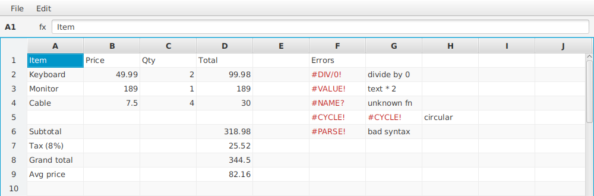

# Java Spreadsheet

A small desktop spreadsheet (a mini Excel) written in Java 21 with JavaFX. Cells hold numbers, text or formulas such as `=A1+B2*2` or `=SUM(A1:A5)`. Formulas are parsed by a hand-written recursive descent parser into a syntax tree. A dependency graph tracks which cells read which, so editing a cell recalculates only the cells that depend on it, in the right order. Circular references are detected and shown as `#CYCLE!`. The app also supports undo/redo, saving and opening sheets, and CSV export.



## Features

- Grid of 26 columns (A–Z) × 100 rows, configurable in code
- Cells: empty, number, text, or formula (starts with `=`)
- Formulas: numbers, cell references, `+ - * / ^`, unary minus, parentheses, ranges inside functions
- Functions: `SUM`, `AVERAGE`, `MIN`, `MAX`, `COUNT`, `ABS`, `ROUND(x, digits)`
- Errors shown in red and passed on to every formula that uses them: `#DIV/0!`, `#REF!`, `#NAME?`, `#PARSE!`, `#VALUE!`, `#CYCLE!`
- Incremental recalculation through a dependency graph, with cycle detection
- Undo/redo (Ctrl+Z / Ctrl+Y), save/open (formulas preserved), export values to CSV
- Formula bar, edit by double-clicking or just typing, status bar with recalculation time

## Build and run

Requires JDK 21 and Maven.

```bash
mvn javafx:run
```

```bash
mvn javafx:run -Djavafx.args=examples/budget.sheet   # open the example
```

## Tests

```bash
mvn test
```

The tests cover the tokenizer, operator precedence (`=2+3*4` is 14, `=2^3^2` is 512), functions over ranges with empty and text cells, every error type, chains, the diamond case, edge removal, cycles, undo/redo, save/load and a performance comparison.

## How it works

```
"=SUM(A1:A3)*2"
      │  Tokenizer        NAME( CELL : CELL ) * NUMBER
      ▼
      │  Parser           BinaryOp('*', FunctionCall(SUM, [Range(A1, A3)]), Number(2))
      ▼
      │  Evaluator        walks the tree, looks up cell values, returns a Value
      ▼
   NumberValue(12)
```

### Formula grammar

The parser has one method per rule. Each rule calls the next tighter-binding one, so precedence comes from the structure of the code:

```
expr    := term (('+'|'-') term)*
term    := power (('*'|'/') power)*
power   := unary ('^' power)?        right-associative: 2^3^2 = 2^9 = 512
unary   := '-' unary | primary
primary := NUMBER | CELL | NAME '(' args ')' | '(' expr ')'
args    := arg (',' arg)*
arg     := CELL ':' CELL | expr
```

The syntax tree is a sealed interface with one record per node type (`NumberNode`, `CellRefNode`, `RangeNode`, `UnaryOpNode`, `BinaryOpNode`, `FunctionCallNode`), and the evaluator is a pattern-matching `switch` over it. Values are a sealed interface too (`NumberValue`, `TextValue`, `ErrorValue`, `EmptyValue`). Functions live in a `FunctionRegistry` map, so adding one needs no parser change. A formula is parsed once, when the cell is edited; recalculation re-evaluates the stored tree.

### Dependency graph and recalculation

The graph keeps two maps: `dependencies` (B1 → {A1} when B1 = A1+1) and `dependents` (the reverse). When a cell is edited:

1. Its old edges are removed, and new ones are added for every cell its formula reads (ranges are expanded).
2. A **BFS** over `dependents` collects the cell and everything that depends on it, directly or indirectly.
3. **Kahn's topological sort** orders that subset, and each cell is evaluated exactly once. In a diamond (B1 and C1 read A1, D1 reads both), D1 is evaluated once, after both of its inputs.
4. Cells that Kahn's algorithm can never reach are on a cycle or read from one, so they get `#CYCLE!`. Editing any cell on the cycle to break it recalculates the others normally.

Only the affected part of the graph is recalculated, in O(V + E) for that subgraph.

On a 10,000-cell chain (`A2 = A1+1`, `A3 = A2+1`, …):

| Change | Cells recalculated | Time |
|---|---:|---:|
| Last cell of the chain | 1 | ~0.08 ms |
| First cell of the chain | 10,000 | ~12 ms |
| Recalculate everything (naive approach) | 10,000 | ~8 ms |

When an edit only affects a few cells, as most edits do, incremental recalculation is about 100× faster than recalculating everything.

### Design

- **Model and UI are separate.** `Spreadsheet` has no JavaFX code. The UI registers a listener and is told which cells changed (observer pattern).
- **Undo/redo uses the command pattern.** Each edit is a `SetCellCommand(address, oldRaw, newRaw)` kept on two `ArrayDeque` stacks. Undo goes through the normal edit path, so the dependency graph stays correct.
- **Sheet files store what the user typed** (`A1<TAB>content`, one line per cell), so formulas are preserved. CSV export writes the computed values.

## Project structure

```
src/main/java/spreadsheet/
  model/    CellAddress, Cell, Value, Spreadsheet, DependencyGraph, UndoManager, SetCellCommand, SheetFileIO
  formula/  Token, Tokenizer, Parser, ast/Node, Evaluator, FunctionRegistry
  ui/       SpreadsheetApp, GridView, FormulaBar
```

## License

MIT, see [LICENSE](LICENSE).
